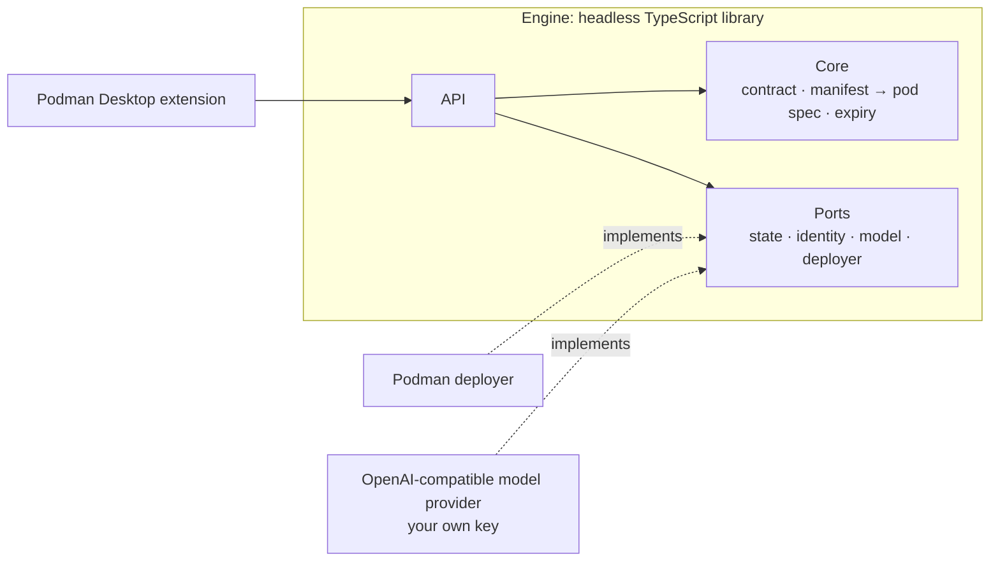
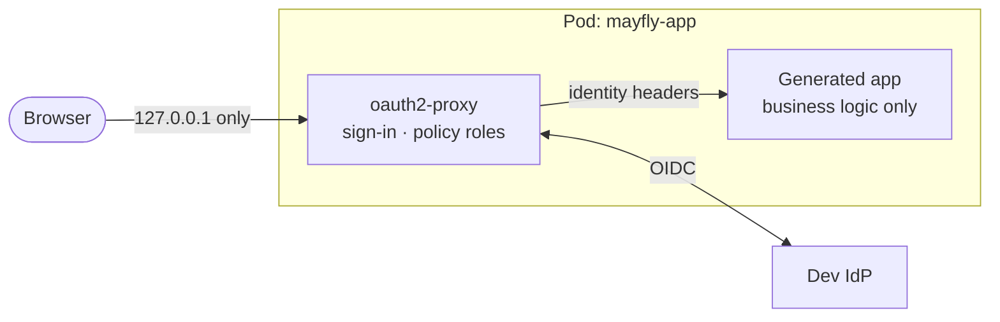

# Mayfly

Describe a small app for a short or routine task. Mayfly builds it and runs it on your machine, behind sign-in, with health checks and JSON logs. The model writes none of those parts.

**Status:** early. The core contract exists. The Podman deployer and the Podman Desktop extension are next.

## Why not Dyad?

[Dyad](https://www.dyad.sh/) and Lovable generate the whole app, including login and logging, so those parts are only as good as the model is that day. Mayfly moves them into a fixed contract that the model cannot weaken, and the model writes business logic only. Every app is production-shaped by construction and can be handed to someone else to run.

## The contract

A generated app:

- is an HTTP service on `$PORT`, configured only through environment variables;
- is stateless, with SQLite locally at most;
- answers `/healthz`;
- logs JSON to stdout;
- never implements login. An OIDC proxy ([oauth2-proxy](https://oauth2-proxy.github.io/oauth2-proxy/)) in front of it authenticates and passes identity to it in trusted headers. Locally, a development IdP stands in for a real one;
- is authorized by role. A policy file outside the app lists the OIDC roles allowed in, and the proxy enforces the list;
- ships as an OCI image plus Kubernetes manifests that `podman kube play` runs;
- is TypeScript on Node with Hono, like every other app.

Every container runs as a non-root user with all capabilities dropped, a read-only root filesystem and CPU and memory limits. Only the proxy is published, and only on loopback.

## Architecture

Dependencies point inward. The core imports nothing else.



Each app runs as one pod:



## Offerings

**Individual** (being built). Local-first, on your own Podman. Power users can later deploy the same image and manifests to their own cloud.

**Enterprise** (not now). IT configures a deployment target and the company IdP once, and creators get a deploy button. The engine and the contract stay the same. A web control plane holds the target, the IdP configuration and each app's policy, and runs the engine on a server. Apps move from a laptop to the company cluster without rewrites because they were cluster-shaped from the start.

**SaaS** (later). Mayfly hosts apps for many customers. This is a different security problem: running untrusted, model-written code for many tenants on shared infrastructure needs strong tenant isolation, abuse controls and billing. Out of scope until Individual and Enterprise work.

## Non-goals

- Login, user databases or sessions inside generated apps.
- Stateful apps in v1.
- More than one stack for generated apps.
- Mobile or WebAssembly targets.
- Container platforms other than Podman, for now. The engine doesn't depend on Podman, so Docker Desktop and Rancher Desktop can come later as new deployers and shells.

## Development

```sh
nvm use            # Node 24
npm install
npm test
npm run typecheck
```
