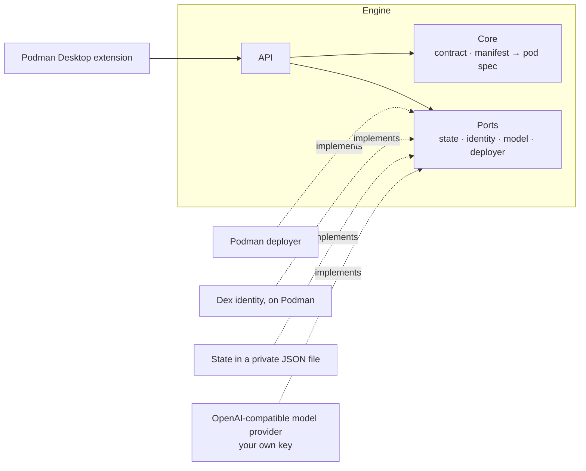
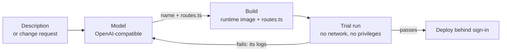
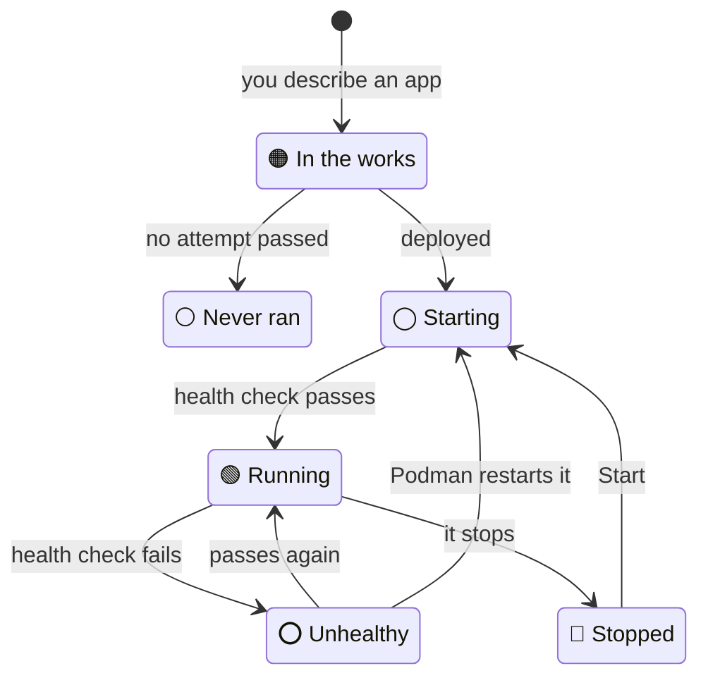
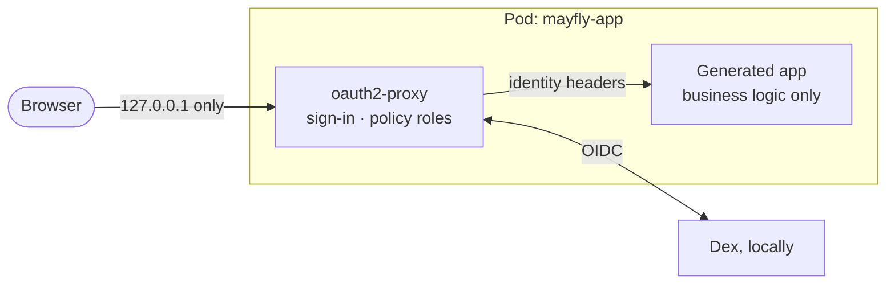

<div align="center">


<h1>Mayfly</h1>

<p><em>Here for a day, built to stay.</em></p>

<p>

<a href="https://nodejs.org"></a>
<a href="https://www.typescriptlang.org"></a>
<a href="https://podman.io"></a>
<a href="https://hono.dev"></a>
<a href="https://oauth2-proxy.github.io/oauth2-proxy/"></a>
</p>

<p>
<a href="https://en.wikipedia.org/wiki/Mayfly"></a>


</p>

</div>

Describe a small web app. Mayfly builds it and runs it locally in Podman behind sign-in. The model writes the app's routes; Mayfly supplies authentication, health checks, logs and container settings.

## Use it

### Prerequisites

- [Podman Desktop](https://podman-desktop.io/) with Podman 5 or later running.
- [OpenAI](https://platform.openai.com/api-keys) or another OpenAI-compatible provider.

### Steps

1. In Podman Desktop, open **Extensions**, choose **Install custom…**, and enter `ghcr.io/jgalego/mayfly-extension:main`.
2. Open **Mayfly → Settings → Models**. The default is OpenAI's `gpt-6.2-sol`. Add a key or choose another provider and model. Podman Desktop stores the key, and Mayfly sends it only to the endpoint it was saved for.
3. Choose **New app** and describe what you need. You can attach images, such as a mockup, and text files with data (`.txt`, `.md`, `.csv`, `.tsv`, `.json`): use the paperclip, or paste or drop them. After deployment, sign in with the email and password under **Sign-in details**, next to **Open app**.
4. Ask for changes in the app's conversation. A successful update replaces the previous version at the same address. Type `/` for commands: `/ask` a question without changing the app, `/fix` the errors it logged, `/retry` your last request, `/undo` the last deploy, `/start` it again after it stopped, or switch its `/model`, `/rename` it or `/remove` it.

The status bar shows app status and token usage. **Settings → General → Enable developer mode** adds the code, available model reasoning, version history, logs and usage reports. You can save an edit from any version without deploying it, or deploy a version that passed its trial.

## Why not Dyad?

Applications like [Dyad](https://www.dyad.sh/) and [Lovable](https://lovable.dev/) generate the whole app, login and logging included, so those parts are only as good as the model was that day. In Mayfly the model writes the business logic and nothing else. Sign-in, health checks, logging and the container setup come from a fixed contract the model can't change, so every app runs the same way and you can hand it to someone else to run.

## The contract

A generated app is one TypeScript file, `routes.ts`, using [Hono](https://hono.dev/) on Node 24. The runtime listens on `$PORT`, serves `/healthz` and writes JSON logs to stdout. The app serves HTML at `/` with a link to `/oauth2/sign_out`. It has no server-side storage; data that must survive a restart can live in the browser.

[oauth2-proxy](https://oauth2-proxy.github.io/oauth2-proxy/) handles sign-in, checks the OIDC `groups` claim against the app's allowed roles and forwards identity in headers. [Dex](https://dexidp.io/) provides local OIDC. The app's port is not published; the proxy listens on loopback.

Mayfly deploys an OCI image and Kubernetes objects with `podman kube play`. Containers run as non-root with a read-only root filesystem, no Linux capabilities and CPU and memory limits. The proxy's ConfigMap sets the identity provider and allowed roles; credentials live in a Secret.

## The runtime image

The runtime image uses Node 24 on [Wolfi](https://github.com/wolfi-dev), built with [apko](https://github.com/chainguard-dev/apko) from locked packages. It has no shell or package manager. Its code is root-owned and read-only to the app. The runtime also sets security headers, limits request bodies to 1 MiB and handles shutdown.

`pixi run check-image` runs these checks locally and in CI:

| What | How |
|---|---|
| Containerfile: base pinned by digest, no `RUN` or `ADD`, numeric non-root user, exec-form entrypoint, no secrets, labels | [OPA](https://www.openpolicyagent.org/) via [conftest](https://www.conftest.dev/): [`containerfile.rego`](policy/containerfile.rego) |
| Reproducible image | Compare two build digests. Use Podman's `overlay` storage to match CI; `vfs` writes layer entries in a different order |
| Image: no shell, package manager or download tool, no setuid files, file ownership and permissions, no tests, 160 MB limit, no secrets in the environment, labels | OPA via conftest: [`image.rego`](policy/image.rego), checked against the image config and filesystem |
| High and critical vulnerabilities | [Grype](https://github.com/anchore/grype) |
| Policy tests | `conftest verify` |

Pre-commit runs [hadolint](https://github.com/hadolint/hadolint) separately.

CI publishes passing `main` builds to [`ghcr.io/jgalego/mayfly-runtime`](https://github.com/JGalego/mayfly/pkgs/container/mayfly-runtime) with commit SHA and `main` tags. It checks the rebuilt digest against the tested image, signs it with [Sigstore](https://www.sigstore.dev/) and attests its SBOM and build provenance. To verify:

```sh
gh attestation verify oci://ghcr.io/jgalego/mayfly-runtime:main --owner JGalego
cosign verify ghcr.io/jgalego/mayfly-runtime:main \
  --certificate-identity-regexp '^https://github.com/JGalego/mayfly/' \
  --certificate-oidc-issuer https://token.actions.githubusercontent.com
```

## Architecture

The Podman Desktop extension calls a TypeScript engine. The core defines the app contract and builds pod specs. The engine uses adapters for state, identity, model calls and deployment.



For each request, Mayfly builds and tests the model's code without network access or elevated privileges. The trial checks that the app starts, answers `/healthz` and serves an HTML home page with a sign-out link. Mayfly sends failures back to the model for up to three attempts in total.



Each app has a light in the sidebar. It is orange while Mayfly works on the app. Otherwise it shows what Podman says, which Mayfly asks every 10 seconds.



Asking for a change turns any light orange, until a new version is deployed or the app is left as it was.

| Light | What it means | What to do |
|---|---|---|
| 🟠 In the works | Mayfly is writing, building, trying or deploying a version. The running version serves until the new one passes, and if none does, the app stays as it was. | Wait, or watch the conversation |
| ⚪ Never ran | No attempt at the app has passed yet. | `/retry`, or ask for it differently |
| ◯ Starting | Podman started the app, and its health check has not passed yet. | Wait a few seconds |
| 🟢 Running | The app is up and its health check passes. | |
| 🟡 Restarted | Running, after Podman restarted it at least once since its last deploy. | Read its logs, or `/fix` |
| ⭕ Unhealthy | Running, but its health check fails. After three failures in a row Podman restarts it, and it starts again. | Read its logs, or `/fix` |
| 🔴 Stopped | Not running, for example after the Podman machine stopped. | **Start**, or `/start`. To have Mayfly start them when Podman Desktop starts, turn on **Settings → General → Start stopped apps automatically**. |

Each app runs as one pod: oauth2-proxy in front, on 127.0.0.1, and the app behind it with no port on the host, so it only sees people who are signed in and allowed.



## Offerings

💻 **Individual** (being built). Runs on your own machine with Podman. Later you'll be able to deploy the same image and manifests to your own cloud.

🏢 **Enterprise** (not now). IT sets up a deployment target and the company IdP once, and after that anyone making an app gets a deploy button. A web control plane runs the same engine on a server and keeps the target, the IdP settings and each app's policy. An app made on a laptop moves to the company cluster unchanged, because it already ships as an image and Kubernetes manifests.

☁️ **SaaS** (later). Mayfly hosts apps for many customers. That's a harder security problem: running model-written code from many customers on shared machines needs strong isolation between them, abuse controls and billing. We won't start it until Individual and Enterprise work.

## Non-goals

- Login, user databases or sessions inside generated apps.
- Server-side persistence.
- Outbound network restrictions after deployment. The app shares a network with the proxy, which needs to reach the identity provider.
- More than one stack for generated apps.
- Mobile or WebAssembly targets.
- Container platforms other than Podman.

## Development

Development requires Node 24 and pre-commit. Image and integration checks also require Podman 5 or later and [pixi](https://pixi.sh).

```sh
nvm use
npm ci && npm ci --prefix runtime
pre-commit install
npm test
npm run typecheck
npm run build:runtime
npm run build:extension
pixi run check-image
npm run test:integration
```

`MAYFLY_LIVE=1 npm run test:integration` also calls the model configured in `.env` and may incur charges.

## License

Copyright © 2026 João Galego.

Mayfly is licensed under the [GNU Affero General Public License v3.0 only](LICENSE). If you run a modified version for others over a network, you must offer them its source.

The runtime uses the [MIT License](runtime/LICENSE), so the apps you make are yours to use, share or sell on any terms.
