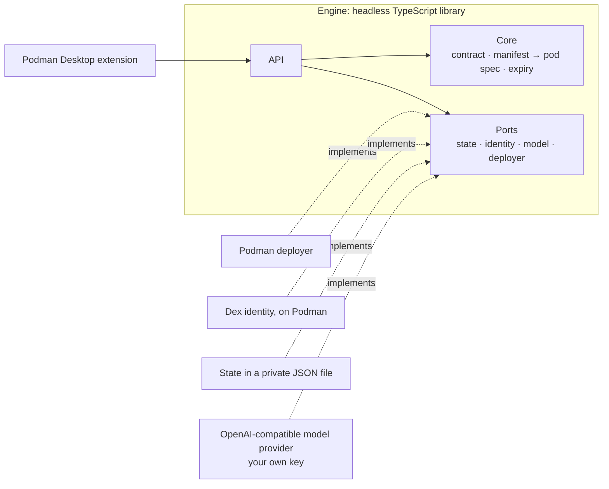
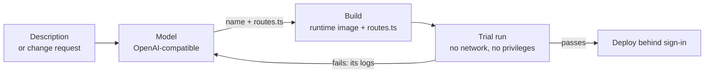

<div align="center">


<h1>Mayfly</h1>

<p><em>Here for a day, built to stay.</em></p>

<p>

<a href="https://nodejs.org"></a>
<a href="https://www.typescriptlang.org"></a>
<a href="https://podman.io"></a>
<a href="https://hono.dev"></a>
<a href="https://oauth2-proxy.github.io/oauth2-proxy/"></a>
</p>

<p>
<a href="https://en.wikipedia.org/wiki/Mayfly"></a>


</p>

</div>

Describe a small app for a short or routine task. Mayfly builds it and runs it on your machine, behind sign-in, with health checks and JSON logs. The model writes none of those parts.

## Use it

### Prerequisites

- [Podman Desktop](https://podman-desktop.io/) with a Podman 5 machine running
- An API key for [OpenAI](https://platform.openai.com/api-keys), or for another service that speaks OpenAI's API

### Steps

1. In Podman Desktop, open **Extensions**, choose **Install custom…**, and enter `ghcr.io/jgalego/mayfly-extension:main`.
2. Open **Mayfly** in the navigation bar. In **Settings**, pick the provider and model and paste your API key. The default is OpenAI with `gpt-6.2-sol`. Podman Desktop keeps the key in its secret storage, and Mayfly sends it only to the endpoint it was saved for.
3. Choose **New app** and say what you need. About a minute later the app opens in your browser. Sign in with the email and password under **Sign-in details**, next to **Open app**; each has a **Copy** button.
4. Each app is a conversation. Ask for a change there, and the new version replaces the old one at the same address.

The status bar shows the model, and the tokens in, out and spent thinking on the app you're looking at and on all apps. To see under the hood, turn on **Settings → Advanced → Enable developer mode**: the code as Mayfly writes it and the model's thinking where its provider shares it, what each change did, every version with a way back to it, a code editor, each app's health and logs, and in Settings what each model spent by day, week or month, and by model, provider or app.

## Why not Dyad?

Applications like [Dyad](https://www.dyad.sh/) and [Lovable](https://lovable.dev/) generate the whole app, login and logging included, so those parts are only as good as the model was that day. In Mayfly the model writes the business logic and nothing else. Sign-in, health checks, logging and the container setup come from a fixed contract the model can't change, so every app runs the same way and you can hand it to someone else to run.

## The contract

A generated app:

- is an HTTP service on `$PORT`, configured only through environment variables;
- is stateless, with SQLite locally at most;
- answers `/healthz`;
- links to `/oauth2/sign_out` from its home page, so people can sign out of it;
- logs JSON to stdout;
- never implements login. An OIDC proxy ([oauth2-proxy](https://oauth2-proxy.github.io/oauth2-proxy/)) in front of it authenticates and passes identity to it in trusted headers. Locally, [Dex](https://dexidp.io/) stands in for a real identity provider;
- is authorized by role. A policy outside the app lists the roles allowed in, read from the OIDC `groups` claim, and the proxy enforces the list;
- ships as an OCI image plus Kubernetes manifests that `podman kube play` runs on Podman 5 or later. To run an app someone handed you, set your identity provider and allowed roles in its one ConfigMap;
- is TypeScript on Node with Hono, like every other app.

Every container runs as a non-root user with all capabilities dropped, a read-only root filesystem and CPU and memory limits. Only the proxy is published, and only on loopback.

## The runtime image

Every app runs on one image: Node 24 on [Wolfi](https://github.com/wolfi-dev), built with [apko](https://github.com/chainguard-dev/apko) from a locked list of packages, plus Mayfly's runtime (identity from the proxy's headers, JSON logs, `/healthz`, security headers, a body limit, graceful shutdown). It has no shell and no package manager, its code is owned by root and read-only to the app, and it is about 150 MB. A generated app adds one file, `routes.ts`.

`pixi run check-image` proves the image meets the policies in [`policy/`](policy/), and CI runs it on every push:

| What | How |
|---|---|
| Containerfile best practices | [hadolint](https://github.com/hadolint/hadolint), on every commit |
| Containerfile: base pinned by digest, no `RUN` or `ADD`, numeric non-root user, exec-form entrypoint, no secrets, labels | [OPA](https://www.openpolicyagent.org/) via [conftest](https://www.conftest.dev/): [`containerfile.rego`](policy/containerfile.rego) |
| The same commit always builds the same image | two clean builds, same digest. With Podman's default `overlay` storage it is also the same digest as on CI; `vfs` writes layer entries in a different order |
| Image: no shell, package manager or download tool, no setuid files, nothing writable by anyone, root-owned read-only code, no tests, under 160 MB, no secrets in the environment, labels | OPA via conftest: [`image.rego`](policy/image.rego), on the built image's config and every file in it |
| No known high or critical vulnerabilities | [Grype](https://github.com/anchore/grype) |
| The policies themselves | Rego tests, `conftest verify` |

Each commit on `main` that passes CI is published to [`ghcr.io/jgalego/mayfly-runtime`](https://github.com/JGalego/mayfly/pkgs/container/mayfly-runtime), tagged with its commit SHA and `main`. CI rebuilds it and publishes it only if it is the exact image that passed the checks above. It is signed with [Sigstore](https://www.sigstore.dev/) and carries an SBOM and build provenance. Check one before you use it:

```sh
gh attestation verify oci://ghcr.io/jgalego/mayfly-runtime:main --owner JGalego
cosign verify ghcr.io/jgalego/mayfly-runtime:main \
  --certificate-identity-regexp '^https://github.com/JGalego/mayfly/' \
  --certificate-oidc-issuer https://token.actions.githubusercontent.com
```

## Architecture

Mayfly's engine is a TypeScript library with a small API. People use it through a UI built on top: the Podman Desktop extension now, a web app for Enterprise and SaaS later. The core holds the contract, turns a manifest into a pod spec and applies expiry rules, and it imports nothing outside itself. Everything else (storage, identity, the model and the deployer) plugs in through small interfaces, the ports below.



An app is made from a description and changed by later requests in its conversation, for which the model starts from the app's current code. The model writes `routes.ts`, Mayfly builds it on the runtime image and tries it out with no network and no privileges, and any failure goes back to the model, up to three times. Only an app that starts, passes its health check and serves an HTML home page with a sign-out link gets deployed.



Each app runs as one pod with two containers: oauth2-proxy and the app. The proxy is the only way in, and you reach it on 127.0.0.1. It signs you in with OIDC, checks your roles against the app's policy and passes the request on with your identity in headers. The app has no port on the host, so it only ever sees people who are signed in and allowed.


## Offerings

💻 **Individual** (being built). Runs on your own machine with Podman. Later you'll be able to deploy the same image and manifests to your own cloud.

🏢 **Enterprise** (not now). IT sets up a deployment target and the company IdP once, and after that anyone making an app gets a deploy button. A web control plane runs the same engine on a server and keeps the target, the IdP settings and each app's policy. An app made on a laptop moves to the company cluster unchanged, because it already ships as an image and Kubernetes manifests.

☁️ **SaaS** (later). Mayfly hosts apps for many customers. That's a harder security problem: running model-written code from many customers on shared machines needs strong isolation between them, abuse controls and billing. We won't start it until Individual and Enterprise work.

## Non-goals

- Login, user databases or sessions inside generated apps.
- Stateful apps in v1.
- Limiting an app's outbound network in v1. The app shares the pod's network with the proxy, which has to reach the identity provider.
- More than one stack for generated apps.
- Mobile or WebAssembly targets.
- Container platforms other than Podman, for now. The engine doesn't depend on Podman, so Docker Desktop and Rancher Desktop can come later as new deployers and shells.

## Development

Needs Node 24, and for the image and integration tests, Podman 5 and [pixi](https://pixi.sh).

```sh
nvm use                                  # Node 24
npm ci && npm ci --prefix runtime
pre-commit install                       # hygiene, Conventional Commits, lint, typecheck, tests, policies on every commit
npm test                                 # unit tests
npm run typecheck
npm run build:runtime                    # the runtime image every app starts from
npm run build:extension                  # the Podman Desktop extension, into extension/
pixi run check-image                     # proves the image meets policy/
npm run test:integration                 # signs in through Dex to a real app on Podman
MAYFLY_LIVE=1 npm run test:integration   # also calls the real model from .env, which costs money
```

CI runs the hooks, checks every commit message, proves the runtime image, and runs the integration tests on Podman 5.

## License

Copyright © 2026 João Galego.

Mayfly is free software under the [GNU Affero General Public License v3.0 only](LICENSE). If you run a changed version for others over a network, you must offer them its source.

The runtime every app runs on, in [`runtime/`](runtime/), is under the [MIT License](runtime/LICENSE) instead, so the apps you make are yours to use, share or sell on any terms.
