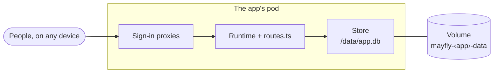
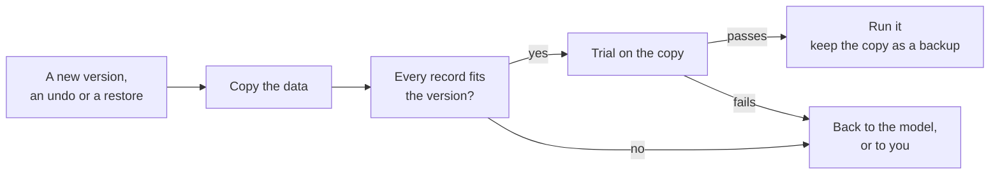

# Design: data that apps keep

Status: on `main`, for 0.5.0. It changes the contract, and takes "Server-side persistence" off the README's non-goals.

Built so far: the store, the check in every trial, undo and deploy on the data, backups with restore and export, rename and remove. Still to build: offering the backup when an undo doesn't fit.

Apps keep data in the browser today. That breaks as soon as an app has more than one browser: two people sharing a tracker each see their own list, an entry made on the phone isn't there on the computer, and clearing the browser deletes it. The goal is data that lives with the app, where the model declares what it keeps and Mayfly makes sure no change can lose it.

## Proposal

The runtime gives each app a store: JSON records by key, in a SQLite file on a volume of the app's own. The app declares the kinds of record it keeps, by key prefix, and the store refuses a write that doesn't fit.

```ts
export const records = {
  "task:": { title: "string", done: "boolean", due: "string?", tags: "string[]?" },
};

app.post("/tasks/:id/done", (c) => {
  const store = c.get("store");
  const key = `task:${c.req.param("id")}`;
  const task = store.get(key); // the record, or undefined
  if (task) store.set(key, { ...task, done: true });
  return c.redirect("/");
});
```

`store.delete(key)` and `store.list("task:")` complete it. One person's records go under a prefix with their email, `note:<email>:<id>`. The store is Node's own `node:sqlite`, so nothing new goes in the image. Its calls are synchronous: Node runs one request at a time between `await`s, so a read and a write with no `await` between them can't interleave with another person's.



The volume is a PersistentVolumeClaim in the app's YAML, as Dex's data already is, so it moves to a cluster unchanged. Only the app's container mounts it, and the rest of its disk stays read-only. A record can be up to 1 MiB, as a request body can, and an app up to 100 MB, which SQLite enforces itself with `max_page_count`.

## One rule: every record fits the version that runs

Data outlives code. Mayfly keeps one rule, and checks it rather than trusting the model with it: the version that runs accepts every stored record.

- **On each write**, the store checks the record against its kind. A version changes only the fields it declares: the store keeps the rest, so an older version can't drop a newer version's fields.
- **Before any version runs**, the trial checks every stored record against that version's kinds, on a copy of the data, inside its sandbox. Then it starts the version on that copy and visits its home page, as it does now.
- **A record that doesn't fit fails the trial.** Mayfly writes the message: the kind, the field, what was expected and how many records, never a value. A new version goes back to the model with it, like any failed trial.

So changes to the data model can only add, and the check enforces it on the real data:

| Change | How | If the model gets it wrong |
|---|---|---|
| A new field | Optional, with a default where it's read: `task.tags ?? []` | Required: older records lack it and fail the check |
| A new kind of record | A new prefix | — |
| A field renamed or reshaped | A new optional field, and the code reads both: `task.deadline ?? task.due` | Retyped in place: older records fail the check |
| A field or kind removed | The code stops reading it. The data stays. | — |

Nothing rewrites stored data in bulk, so there's no migration to get wrong. The cost is old fields that stay around, which doesn't matter at this size.

Models write good SQL, but a migration is the one piece of code where a wrong answer destroys data instead of hiding it. It runs once against the real data, `/undo` can't take it back, and a rewrite of `routes.ts` can drop old steps. Undo would still need every change to only add, so SQL would bring the same rule plus a migration for each change. What SQL adds is queries, joins and indexes, and an app with a few thousand records does without them: the store filters them in memory.

## Rollbacks

Every change of code or data goes through the same check. Before each one, Mayfly copies the data. The check and the trial run on the copy, and the copy is kept as a backup.



- **Undo** puts back the code and keeps the data. Changes only add, and the store keeps fields a version doesn't declare, so the version going back almost always fits. When it doesn't, Mayfly says which records don't fit and offers the backup from before the undone version.
- **Restore** puts back the data from before one of the last three deploys. Anything written since is lost, so Mayfly says when the backup was made and asks first. The data it replaces becomes a backup too, so a restore can be undone the same way. It sits in developer mode's **Data** tab, with **Export**, which saves the data as a JSON file.
- **Rename** copies the data to the new name's volume.
- **Remove** deletes the data, after offering an export. A volume left behind would hand old data to the next app with that name, and maybe to other people.

## Not a setting

The store needs no switch, in Settings or elsewhere. Once an app keeps data, turning a setting off would break the app or strand its data, so it couldn't really go back off. And unlike phone access, the store doesn't widen who can reach what. It's per app instead: only an app that declares records gets a volume, and apps that don't keep data stay as they are. Until the questions below are answered, it stays on a branch, as phone creation does.

## Security

- **Each app sees only its own data.** Its volume mounts in its own container, not in the proxies' or any other pod.
- **The data never goes to the model.** The declared kinds say what the records look like, and the check's messages name fields, never values.
- **The disk stays read-only** except `/data`.
- **The trial still has no network.** It gets a throwaway copy, deleted with its container.
- **The data rests unencrypted** on the computer's disk, as Mayfly's own state does.

## Options considered

| Option | Catch | Verdict |
|---|---|---|
| Browser storage, as now | One copy per browser: no sharing, not on the phone, gone with the browser | for per-device settings only |
| SQLite, with the model writing the schema and migrations | A wrong migration destroys data, and undo can't take it back | no |
| SQLite, with Mayfly applying a declared schema's safe changes | A migrator in the runtime, for queries small apps don't need | later, if apps outgrow the store |
| Records with TypeScript types only | Nothing checks that old records fit, so a wrong change shows up as a broken page after it deploys | no |
| Files under `/data` | The model writes storage code, with partial writes and no checks | no |
| A store container next to the app | Calls over the network are asynchronous, so a read and a write can interleave | no |
| **Declared records by key, in SQLite, through the runtime** | Filtering in memory, and old fields stay around | **yes** |

## Questions for the spike

1. ~~Does `node:sqlite` work in the runtime image?~~ Answered: yes, in the image `main` published at `bdd848e` (Node 24.22.3), as `nobody` on a read-only root, with no flag and no warning.
2. ~~Can a pod give the app's user a volume it can write?~~ Answered on Podman 5.8.9: a PersistentVolumeClaim with `volume.podman.io/uid` and `volume.podman.io/gid` set to 65534 mounts writable for the app's user, while writes elsewhere get `EROFS`. The data survives `kube play --replace` and `kube down`. `kube down --force`, which removing an app runs, deletes every volume the pod mounts, through the pod's claim alone, and fails with "no such volume" when the claim is listed too. So removing leaves the claim out, and renaming stops the pod with `kube down` before it copies the data.
3. How should kinds be declared: the short form above or a subset of JSON Schema? Measure which the model writes more reliably, on the same requests.
4. Can Podman cap a volume's size? The store's limit holds only for code that uses it, and the app can write to `/data` directly.
5. ~~How should the data be copied before each change?~~ Answered: SQLite's `VACUUM INTO`, in a sandboxed container of the runtime image, with the app's volume mounted read-only. It copies a consistent snapshot while the app writes, where a tar of the volume could catch a write halfway. Still to measure: how long it takes for 100 MB.
6. Should each person get an id that never changes? `user.id` is the email today, since oauth2-proxy's user id claim defaults to `email` (`pkg/apis/options/providers.go` in v7.15.6). The owner can change their email, which would leave their records under the old one.
7. Apps that keep data in localStorage today: when one changes, how does its data move to the store, given that it sits in each browser?
