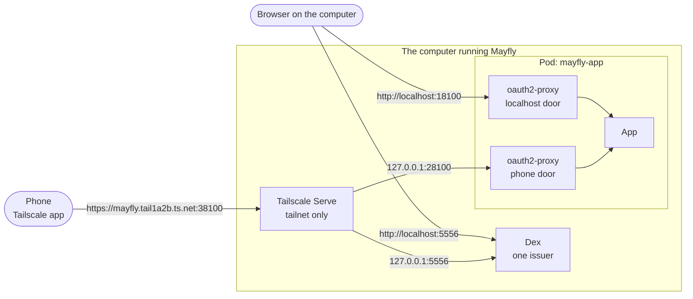
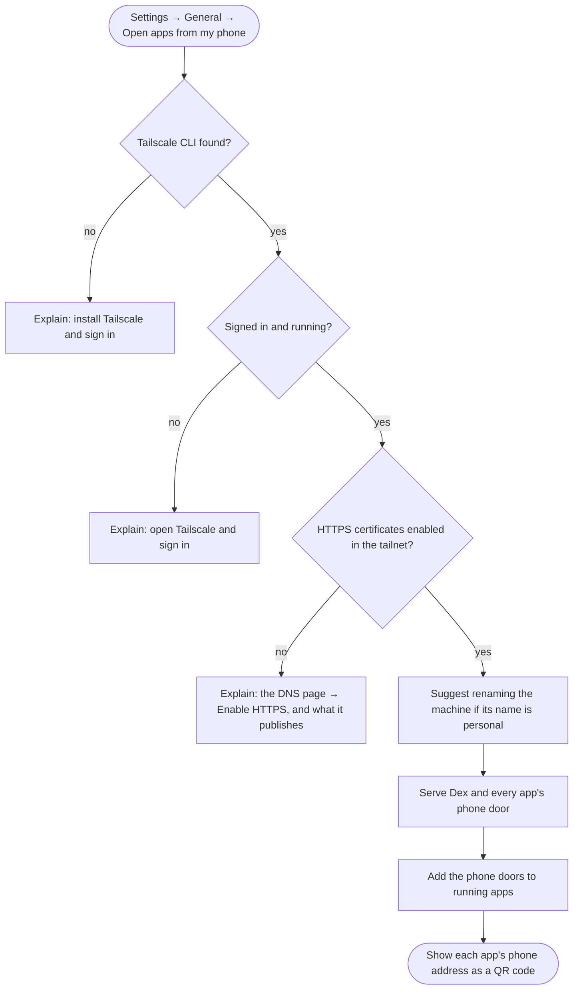

# Design: open apps from your phone

Status: built on `feat/phone-access`, all six steps. What's left is a try of the branch build in Podman Desktop, and after merging, moving the extension's runtime pin to the runtime `main` publishes.

Today every app and Dex listen on `127.0.0.1`, and sign-in uses `http://localhost` URLs, so only the machine running Mayfly can open its apps. The goal is for the owner to open them from their phone too, with the same sign-in, without exposing them to the local network or the internet, and without changing how they open on the computer.

## Proposal

An opt-in setting, off by default, that gives each app a second front door for the phone, always over HTTPS. The localhost door stays exactly as it is. The phone door is a second oauth2-proxy in the app's pod, on its own loopback port, reached only through [Tailscale Serve](https://tailscale.com/kb/1312/serve) on the computer's tailnet name. The phone joins the owner's tailnet with the Tailscale app. Nothing listens on the LAN.

The phone uses its own port numbers, the computer's plus 20000, so Serve never listens on a number Podman publishes. Under WSL's mirrored networking the two would collide whatever their addresses. Serve forwards the phone's port to the phone door, on the app's port plus 10000: `tailscale serve --bg --https=38100 http://127.0.0.1:28100`. With `--bg`, it keeps serving across restarts until Mayfly turns it off with `tailscale serve --https=38100 off`. Sign-in is served the same way, from 25556 to Dex on 5556.

## The two doors

| | Localhost door (today, unchanged) | Phone door (new) |
|---|---|---|
| Address | `http://localhost:18100/` | `https://<machine>.<tailnet>.ts.net:38100/` |
| Listens on | `127.0.0.1:18100` | `127.0.0.1:28100`, reached only through Serve |
| Sign-in page | `http://localhost:5556/dex` | the tailnet name, port 25556, through Serve |
| Redirect URL | `http://localhost:18100/.mayfly/callback` | the same path on the tailnet name, port 38100 |
| Cookie | not Secure | Secure |
| Dex issuer, checked in tokens | `http://localhost:5556/dex` | the same |

One Dex serves both doors and its issuer never changes. Dex 2.46.1 sends browsers to paths during the password login, not to full URLs (`url.URL{Path: IssuerURL.AbsPath(...)}` in `server/authflow/login.go`). Its form posts back to the request's own URL, so a phone that reached Dex on the tailnet name stays there. The only absolute redirect is to the client's redirect URI, and each app's Dex client lists both doors' callbacks. Both proxies fetch tokens over the Mayfly network and check the same issuer.

Turning the setting on adds the phone doors and the Serve mappings, and turning it off takes them away. The localhost doors aren't touched, so nobody on the computer signs in again. Creating an app adds its phone door and removing it takes the door away. Renaming keeps the port, so the mapping stays. The state keeps the tailnet name while the setting is on.

## HTTPS only

The phone always uses HTTPS, with Tailscale's certificate for the tailnet name. That gives a padlock, a Secure cookie, and every web feature an app might use on the phone, such as the camera or location. Plain HTTP over the tailnet was considered and dropped: WireGuard encrypts it, but the browser would call it not secure and withhold those features.

The cost is that the certificate puts the name `<machine>.<tailnet>.ts.net` in public [certificate transparency logs](https://tailscale.com/kb/1153/enabling-https). The tailnet part is already random: `tail<hex>`, or a [randomized two-word name](https://tailscale.com/kb/1217/tailnet-name). Before enabling HTTPS, the setting suggests [renaming the machine](https://tailscale.com/kb/1098/machine-names) to something that says nothing about its owner, such as `mayfly`. The logs then show only that some tailnet has a machine called `mayfly`.

## Turning it on

## Which Tailscale plan

Mayfly drives the Tailscale the person already runs, so the plan is theirs, not Mayfly's. Tailscale's free Personal plan allows 6 users and unlimited personal devices for non-commercial use. The Standard plan, $8 per user per month, allows commercial use ([pricing](https://tailscale.com/pricing)).

## Options considered

| Option | Terms | Catch | Verdict |
|---|---|---|---|
| Publish on the LAN (`0.0.0.0`) | none | Self-signed certificates, or a local CA installed on the phone, and anyone on the same Wi-Fi reaches the sign-in page | no |
| Public tunnel (Tailscale Funnel, Cloudflare Tunnel) | varies | Sign-in faces the internet: SaaS-level risk | no |
| Tailscale Serve | Personal plan free for non-commercial use, Standard plan for commercial | Machine name in certificate transparency logs | **yes, first** |
| [Headscale](https://headscale.net/stable/about/clients/) | BSD-3, self-hosted, official Tailscale apps connect | A server with a public IP and a domain. No `ts.net` certificates, so HTTPS needs your own domain and certificates. Whether Serve works under it is unverified. | later, if asked for |
| [NetBird](https://netbird.io/pricing) | Free cloud: 5 users, 100 machines, "for individuals or small teams", no non-commercial clause found. Open source and self-hostable. | No Serve equivalent verified, so the phone door would listen on NetBird's address, with your own certificate | later, through the private-address mode |
| [ZeroTier](https://zerotier.com/pricing) | Free plan non-commercial, 10 devices | No better than Tailscale's terms | no |
| Cloudflare Zero Trust | free-plan terms unverified | Traffic passes through Cloudflare | no |
| Plain WireGuard | none | A phone and a computer both behind NAT need a public endpoint or a relay | no |

A later mode could serve any private network: the phone door listens on the network's own address instead of loopback. It would still be HTTPS only, so it needs a certificate for that address, which means the person's own domain. That covers Headscale, NetBird, ZeroTier and WireGuard without Serve.

## Security

- **Two gates.** The tailnet decides which devices can connect, and Dex still decides who signs in. Nothing is reachable from the LAN or the internet.
- **Identity comes only from the proxy.** Serve adds `Tailscale-User-Login` and similar headers. The spike saw the tailnet user's email arrive at the phone door, and oauth2-proxy passes such headers through to the app. The app's identity comes only from the proxy's `X-Forwarded-*` headers. The runtime should drop Tailscale's headers, so no app comes to rely on them.
- **If Tailscale stops,** only the phone loses access. The computer still opens apps on localhost, and the doctor reports it.

## Questions for the spike

1. ~~Does Serve accept any HTTPS and HTTP port?~~ Answered on Windows: it accepted HTTP on 5556, 18197 to 18199 and 65000, and HTTPS on 18198. Serve routes by hostname: the full name and the short name `mayfly` work, and the bare tailnet IP gets a 404. Phone addresses must use the full name, which is also the only one the certificate covers.
2. Can Serve listen on the tailnet address's port 18100 while Podman holds `127.0.0.1:18100`? Answered on Windows: yes, whichever binds first. Serve on port 5556 worked while the Podman machine held `127.0.0.1:5556`. A Windows process could bind `127.0.0.1:18197` after Serve held that port, and Serve still reached its target. One catch: with WSL's mirrored networking, a process inside WSL shares port numbers with Windows across addresses. So a WSL process on `127.0.0.1:18199` and Serve on 18199 block each other. The spike's Podman machine wasn't under mirrored networking, but a Podman machine is a WSL distro, and later one that was hit this: a connection Tailscale kept on the tailnet address's port 5556 stopped Dex from binding `127.0.0.1:5556`. So the phone now uses its own port numbers, 20000 above the computer's. Linux and macOS are still to check.
3. ~~Does one Dex sign in through both doors end to end?~~ Answered: yes. A throwaway rig ran the core's phone door and Mayfly's Dex on WSL's Podman, behind Windows' Serve. An iPhone on the tailnet opened `https://<machine>.<tailnet>.ts.net:18199/`, signed in on Dex's page on the tailnet name, and reached the app. Dex's pages and static files worked there, and the proxy logged the iPhone's sign-in and requests. A browser on the computer did the same through the tailnet name.
4. ~~Does the HTTP mode need only MagicDNS?~~ Dropped with the HTTP mode.
5. ~~Which fields of `tailscale status --json` give the tailnet name and say whether HTTPS is enabled?~~ Answered on Windows: `Self.DNSName` is the machine's tailnet name with a trailing dot, and `CertDomains` lists it once HTTPS certificates are enabled. `Self.HostName` is the OS hostname, not the tailnet name. Tailscale warns the format may change.
6. ~~How long does the first HTTPS request wait while the certificate is issued?~~ Answered on Windows: 0.92 s for the first request and 0.10 s for the next, with a certificate Windows trusts. Nobody needs to wait for anything.
7. Where is the CLI on each platform, and what does Linux need? On Windows it's `C:\Program Files\Tailscale\tailscale.exe`, and serving ports works without elevation. On Linux, `tailscale set --operator=$USER` lets a non-root user manage Serve. On macOS, the App Store build's CLI is `/Applications/Tailscale.app/Contents/MacOS/Tailscale`. Linux and macOS are still to check.
8. Does Serve work against a Headscale server, and with which certificates? Later, with Headscale.

## Setting up Tailscale for the spike

On Windows, install Tailscale on Windows itself, where Podman Desktop runs, not inside WSL. From WSL, its CLI is `/mnt/c/Program Files/Tailscale/tailscale.exe`.

1. Create an account at https://login.tailscale.com/start with a personal Google, Microsoft, GitHub or Apple account. That's the free Personal plan.
2. Install Tailscale on the computer from https://tailscale.com/download, then log in from its tray or menu bar icon with the same account.
3. Install the Tailscale app on the phone from the App Store or Google Play, sign in with the same account, and allow the VPN.
4. At https://login.tailscale.com/admin/machines, open the computer's **…** menu → **Edit machine name**, untick **Auto-generate from OS hostname**, and name it `mayfly`.
5. At https://login.tailscale.com/admin/dns:
   1. Keep the `tail….ts.net` tailnet name or pick a random two-word one. It can't change after HTTPS is enabled.
   2. Make sure MagicDNS is on.
   3. Under **HTTPS Certificates**, choose **Enable HTTPS**. This publishes `mayfly.<tailnet>.ts.net` in public certificate logs.
6. The phone app should list `mayfly` as connected.

## Plan

Each step is its own commit on this branch, behind the setting, so `main` stays releasable.

1. ~~**Core, tests first.**~~ Done: the phone door container (its port, redirect URL, sign-in page and Secure cookie) from the app and the tailnet name.
2. ~~**Adapter.**~~ Done: a thin Tailscale CLI wrapper that finds the CLI, reads its status, serves a port and stops serving it. Its integration tests skip when Tailscale isn't ready. From WSL, `MAYFLY_TAILSCALE="/mnt/c/Program Files/Tailscale/tailscale.exe"` points them at Windows' CLI.
3. ~~**Engine.**~~ Done: the tailnet name in the state while phone access is on, `turnOnPhone` and `turnOffPhone`, phone doors and Serve mappings kept in line with the apps, and Dex clients listing both doors' callbacks. Turning it on refuses, saying what to do, until Tailscale is ready.
4. ~~**Shell.**~~ Done: **Settings → General → Open apps from my phone**, with the certificate log warning and the rename suggestion. A "Phone access" setup check while it's on. **On your phone** in each app's header, with its address as a QR code, drawn with [uqr](https://github.com/unjs/uqr).
5. ~~**Runtime.**~~ Done: the runtime drops `Tailscale-*` headers before the app sees them. Apps get it once `main` publishes the new runtime and the extension's pin moves to it.
6. ~~**README.**~~ Done: how to set it up and what it publishes, in both READMEs, and the phone door in the pod diagram.

Later: the private-address mode for networks other than Tailscale.
