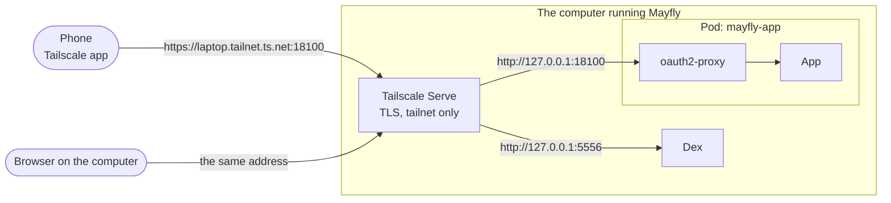
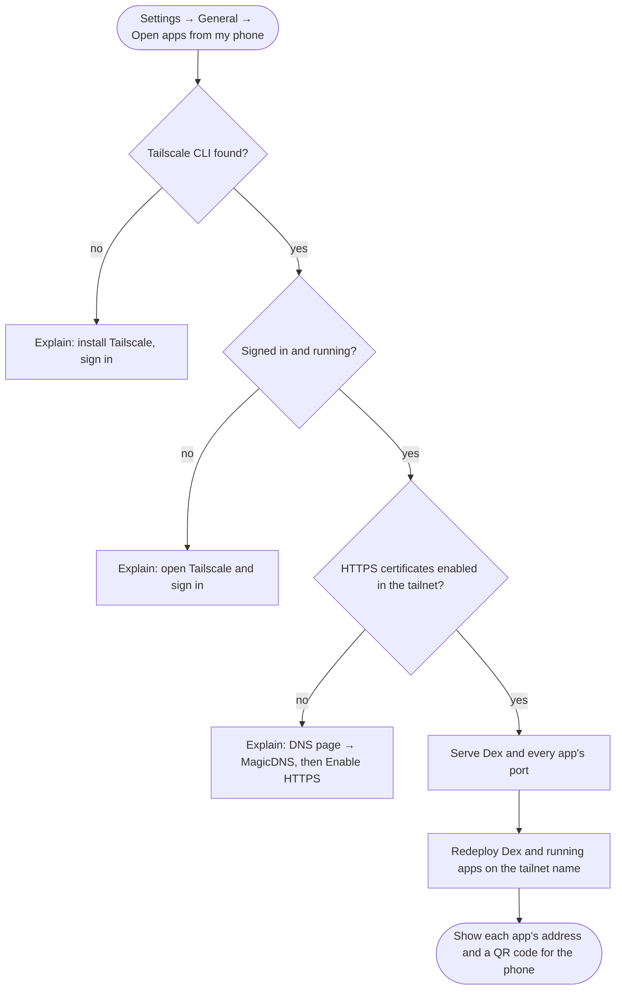

# Design: open apps from your phone

Status: proposal. Nothing here is built yet.

Today every app and Dex listen on `127.0.0.1`, and sign-in uses `http://localhost` URLs, so only the machine running Mayfly can open its apps. The goal is for the owner to open them from their phone too, with HTTPS and the same sign-in, without exposing them to the local network or the internet.

## Proposal

An opt-in setting, off by default, that puts [Tailscale Serve](https://tailscale.com/kb/1312/serve) in front of each app and Dex. The phone joins the owner's tailnet with the Tailscale app. Serve answers on the computer's tailnet name with a certificate Tailscale provisions, and proxies to the port that already listens on loopback. Nothing listens on the LAN, and the pods don't change.

Each port is served on the same number on the tailnet name: `tailscale serve --bg --https=18100 http://127.0.0.1:18100`. `--bg` keeps it across restarts until Mayfly turns it off with `tailscale serve --https=18100 off`.

## What changes

Dex has one issuer and every proxy has one login URL, so with the setting on, the computer uses the tailnet name too. There is a single origin, not one per device.

| | Today | With phone access |
|---|---|---|
| App address | `http://localhost:18100/` | `https://<machine>.<tailnet>.ts.net:18100/` |
| Dex issuer and login URL | `http://localhost:5556/dex` | `https://<machine>.<tailnet>.ts.net:5556/dex` |
| Proxy redirect URL and Dex client | `http://localhost:<port>/oauth2/callback` | the same path on the tailnet name |
| Sign-in cookie | `--cookie-secure=false` | `--cookie-secure=true` |
| Ports published | `127.0.0.1` only | `127.0.0.1` only, unchanged |
| Proxy to Dex (token, keys) | `http://mayfly-dex:5556` on the Mayfly network | unchanged |

Turning the setting on or off redeploys Dex and every running app with the new URLs. Apps keep their ports, and everyone signs in again. Creating an app adds its Serve mapping and removing it takes it away. Renaming keeps the port, so the mapping stays.

The state keeps the tailnet name while the setting is on, so URLs don't depend on Tailscale answering at that moment.

## Turning it on

The setting explains, before it does anything, that enabling HTTPS publishes the computer's name in public certificate transparency logs ([Tailscale's warning](https://tailscale.com/kb/1153/enabling-https)).

## Options considered

| Option | On the phone | Certificate | Who can reach the sign-in page | Verdict |
|---|---|---|---|---|
| Publish on the LAN (`0.0.0.0`) | nothing | self-signed, or a local CA installed on the phone | anyone on the same Wi-Fi | no: certificate pain, and café Wi-Fi |
| Public tunnel (Tailscale Funnel, Cloudflare Tunnel) | nothing | real | the internet | no: sign-in faces the internet, which is SaaS-level risk |
| Tailscale Serve | Tailscale app, same account | real, automatic | devices on the tailnet the ACL allows | **yes** |
| Headscale (self-hosted control server) | Tailscale app pointed at it | no `ts.net` certificates: your own domain and ACME | same as Tailscale | later, if asked for |
| Plain WireGuard | keys set up by hand | none built in | peers | no: no names or certificates |

## Security

- Two gates: the tailnet decides which devices can connect, and Dex still decides who signs in. Nothing is reachable from the LAN or the internet.
- Serve adds `Tailscale-User-Login` and similar headers, which oauth2-proxy passes through to the app. The app's identity still comes only from the proxy's `X-Forwarded-*` headers. The runtime should drop Tailscale's headers, so an app can't come to rely on them.
- If Tailscale stops on the computer, the apps are unreachable there too until it's back or the setting is turned off. The doctor reports it.
- The free Personal plan allows 6 users and unlimited personal devices, for non-commercial use ([pricing](https://tailscale.com/pricing)).

## Questions for the spike

1. Does Serve accept any HTTPS port, including 5556 and 18100 and up? Funnel is limited to 443, 8443 and 10000. The Serve docs list no limit, but don't say there is none either.
2. Does Serve on the tailnet address coexist with Podman holding the same port on `127.0.0.1`, on Linux, and with the Podman machine on Windows and macOS?
3. Can the computer open its own tailnet name, including under WSL's mirrored networking?
4. Which fields of `tailscale status --json` give the tailnet name and say whether HTTPS is enabled? Tailscale warns the format may change.
5. Does Dex work with an `https` issuer while it serves plain HTTP behind Serve?
6. How long does the first request wait while the certificate is issued, and what does the person see?
7. Where is the CLI on each platform, and what does Linux need: `tailscale set --operator=$USER` lets a non-root user manage Serve. On macOS the App Store build's CLI is `/Applications/Tailscale.app/Contents/MacOS/Tailscale`.

## Plan

Each step is its own commit on this branch, behind the setting, so `main` stays releasable.

1. Core, tests first: URLs built from an origin (`http://localhost` or `https://<name>`), and the proxy's cookie setting following it.
2. Dex: issuer, login URL and clients from the origin.
3. Adapter: a thin Tailscale CLI wrapper (find it, read status, serve a port, stop serving it), with integration tests that skip when Tailscale isn't there.
4. Engine: the setting in the state, Serve mappings kept in line with the apps, and a redeploy when it changes.
5. Shell: the setting and its checks in Settings → General, the doctor's Tailscale check, and a QR code for each app's address.
6. Runtime: drop `Tailscale-*` headers before the app sees them.
7. README: how to set it up, and what it exposes.
