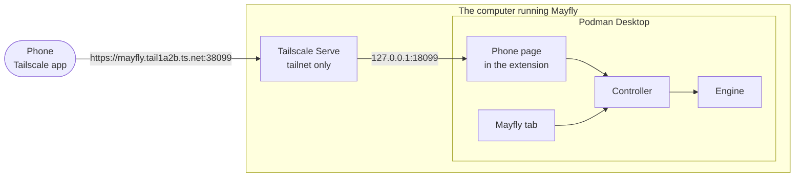

# Design: make apps from your phone

Status: proposed, on `feat/phone-creation`. Spike next.

Phone access lets the phone open apps. The goal now is for the owner to make and change apps from the phone too: describe an app, attach a photo of a sketch, watch Mayfly work, and open the result. With no new account, nothing leaving the machine that doesn't already, and no more power on the phone than making apps needs.

## Proposal

An opt-in setting, off by default, that needs phone access on: **Make apps from my phone**. The extension serves a page for the phone on a loopback port, and Tailscale Serve puts it on the computer's tailnet name over HTTPS, like the apps' phone doors. The phone pairs once, by scanning a QR code on the computer, and adds the page to its Home Screen.

The page listens on `127.0.0.1:18099`, just below the first app's port, and the phone reaches it on 38099, 20000 above, as with the apps. If another program holds 18099, the extension takes the next free port, and Serve still maps 38099 to it. The phone's port never moves: it's part of the page's origin, and the phone's pairing lives in that origin's storage.

## Pairing, not a password

The phone proves it's the owner's once, by scanning a QR code that **Settings → General** shows. The code links to the page with a one-time secret in the URL's fragment, which browsers never send in a request. The page posts it to the extension and gets a device token back: 256 random bits the page keeps in its own storage and sends in an `Authorization` header with each request. The extension keeps only the token's SHA-256 hash, in the state. The secret works once, for 5 minutes. Settings lists paired phones, each with **Forget**, and turning the setting off forgets them all.

The token can't be a cookie. Cookies don't keep ports apart ([RFC 6265 §8.5](https://www.rfc-editor.org/rfc/rfc6265.html#section-8.5)): the phone's browser would send a cookie set on 38099 with every request to the same name, including the apps' phone doors, and oauth2-proxy passes the `Cookie` header on to the app. A model-written app would hold the session. Page storage is per origin, and the port is part of the origin, so no app can read the token, and no request carries it unless the page adds it. With nothing the browser attaches on its own, there's no cross-site request forgery to guard against either.

The same reach rules out signing in with Dex. Dex keeps its single sign-on cookie on the tailnet name, with path `/dex` (`server/session/session.go` in v2.46.1), so an app could have the phone's browser send it to the app's own `/dex/` path. From the Mayfly network, which apps share with Dex, that cookie may get sign-in codes without the password. Dex also runs only while an app exists, and the phone should be able to make the first one.

## What the phone can do

| On the phone | On the computer only |
|---|---|
| The apps and their lights | Models and API keys |
| A new app, with photos and files, the camera included | People, sharing and passwords |
| A change, `/ask`, `/fix`, `/retry`, `/undo`, `/start` | The mail account |
| Opening an app at its phone address | Developer mode: code, versions, logs, usage |
| | `/remove`, `/rename`, `/model` |

A lost phone that's still paired can spend model money and change apps until it's forgotten. It can't read a secret or take anything away. The extension checks each message from the phone against this list, and the phone gets a smaller state: no people, owner, models or mail account.

## One controller, two pages

Today the controller lives with the Mayfly tab and goes when the tab closes. It moves up to the extension, and its `post` sends to every page that's open: the tab and each connected phone. Progress shows on both. The controller works on one request at a time, so the phone and the computer can't start two at once.

The phone page sends each message with `fetch`, and reads the extension's messages as JSON lines from one long `GET /events`, which carries the token too. `EventSource` can't send an `Authorization` header, and Node has no WebSocket server of its own, so this needs no dependency. On every connect the extension sends the state first, so a phone back from sleep just connects again.

The page is a phone layout of the app list and a conversation, built from the Mayfly tab's modules for messages, progress and uploads. A web app manifest and the Mayfly icon let **Add to Home Screen** open it full screen. Safari deletes a site's storage after 7 days without a visit, which would unpair the phone, but [a Home Screen web app counts only the days it's used](https://webkit.org/blog/10218/full-third-party-cookie-blocking-and-more/). Photos are scaled down on the phone to fit the 5 MB image limit.

Mayfly runs inside Podman Desktop, so the page answers only while the computer is awake and Podman Desktop is open. The apps already need that.

## Security

- **Three gates.** The tailnet decides which devices can connect, pairing decides which of them is the owner's phone, and the list above decides what it can do.
- **Nothing new leaves the machine.** Requests go from the phone over the tailnet to the computer.
- **Apps can't reach the session.** The token lives in the page's own storage, never in a cookie.
- **The loopback port trusts nobody.** A request without a valid token gets a 401, whoever sends it. In the spike, containers reached neither the computer's loopback nor its tailnet address, but nothing depends on that.
- **The page loads only itself.** A Content-Security-Policy allows scripts, styles and connections from its own origin only.

Found along the way, and confirmed by question 7: by the same RFC, an app sees Dex's single sign-on cookie and the other apps' oauth2-proxy cookies, since oauth2-proxy forwards the `Cookie` header, and it can use them to act as whoever opened it in every other app. That's a bug in what's released, for a fix of its own. The fix belongs in front of the app, not in the runtime: the app's code runs in the runtime's process and could read the headers before the runtime drops them.

## Options considered

| Option | Catch | Verdict |
|---|---|---|
| A Telegram bot | Telegram's servers see every request and attachment: bot chats aren't end-to-end encrypted. A bot token to create and keep. | later, as another shell, if asked for |
| WhatsApp's Business Cloud API | A public webhook, the internet exposure phone access ruled out, and a Meta business account | no |
| Signing in with Dex | Its single sign-on cookie reaches apps, an OIDC client in the extension, and no Dex before the first app | no |
| A session cookie, with Origin checks | Cookies reach every app on the tailnet name | no |
| Tailscale's identity headers | Anything that reaches the loopback port can send them | no |
| **Pairing with a QR code, the token in page storage** | One pairing per phone. How iOS keeps the storage is for the spike. | **yes** |

## Questions for the spike

1. ~~Can an app's container reach a server the extension runs on loopback?~~ Answered on WSL's Podman, under mirrored networking: no. With a server up on `127.0.0.1:18099`, containers on bridge networks got "connection refused" from `host.containers.internal`, the host's own addresses and its tailnet address. They didn't reach Serve's ports on the tailnet name either. Still to check on a Podman machine, macOS and Linux.
2. ~~Does the page's port close when Podman Desktop stops, updates or reloads the extension?~~ Answered from Podman Desktop's source: `deactivateExtension` awaits the extension's `deactivate`, then disposes `context.subscriptions` (`packages/main/src/plugin/extension/extension-loader.ts`). Closing the server in a subscription frees the port.
3. Do JSON lines reach iOS Safari through Serve as they're written, and does the stream pick up again after the phone sleeps? Half answered on Windows: Serve passed each line on as it was written, a second apart, whether the response said `application/x-ndjson` or `text/event-stream`. The iPhone is still to check.
4. Does a pairing made in Safari carry over to the Home Screen app? If not, does Add to Home Screen keep the pairing link's fragment?
5. Does a file input open the camera from the Home Screen app, and what type and size are the photos?
6. What does the phone show when Podman Desktop is closed? Can a service worker show the page's own message instead? Half answered on Windows: with nothing on the loopback port, Serve answers `502 Bad Gateway` with an empty body, so without a service worker the phone gets a blank page. The service worker is still to check on the iPhone.
7. ~~Can an app read Dex's single sign-on cookie through its own `/dex/` path?~~ Answered on WSL's Podman, with Dex and two apps deployed as Mayfly deploys them: yes, and more. App B's server received app A's session cookie on every path, and Dex's `dex_session` on `/dex/anything`. From a container on the Mayfly network, with only those cookies, B got into A as the owner twice: by replaying A's cookie to A's proxy, and by signing in to A afresh with Dex's cookie and no password.

## Plan

Each step is its own commit on this branch, behind the setting, so `main` stays releasable.

1. ~~**Engine, tests first.**~~ Done: pairing in the engine, with one-time codes kept in memory, device tokens kept as hashes in the state, and forgetting a phone. The phone's list of messages and its smaller state, in the shell.
2. **One controller.** The controller moves up to the extension and posts to every open page.
3. **The phone server.** `node:http` on loopback: the token check, the message list, the events stream, and Serve's mapping on 38099 through the Tailscale adapter.
4. **The phone page.** The app list and the conversation for a phone, the manifest and icon, pairing, and photos scaled down.
5. **Settings.** **Make apps from my phone**, the pairing QR code, paired phones with **Forget**, and a setup check.
6. **README.** How to pair and what the phone can do, in both READMEs, and the page in the architecture diagram.
